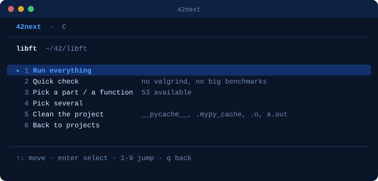
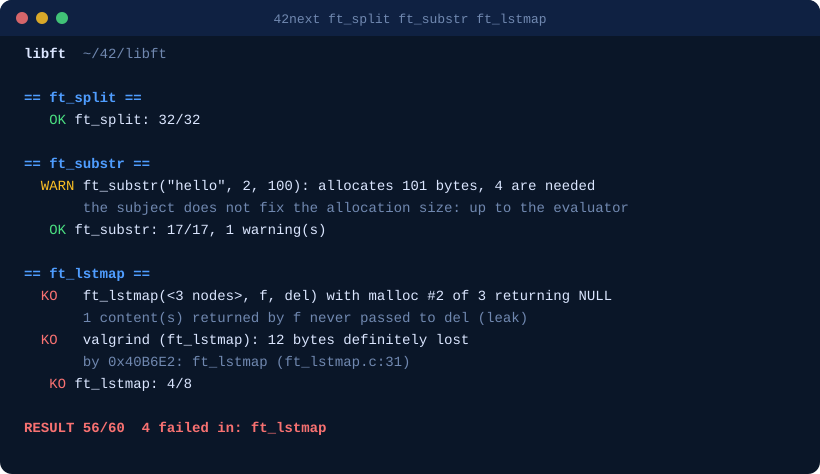

# 42next

[](https://github.com/maxencelobry/42next/stargazers)
[](LICENSE)

A tester for 42 projects that tells you exactly what is wrong. Run it in your
project folder: it finds the project and tests one function or everything.
For each failure it shows the exact call, the expected and actual output, and
any leak, norm or Makefile problem. No config, and your folder is never
modified.



## Install

```sh
git clone https://github.com/maxencelobry/42next.git ~/42next
~/42next/install.sh
```

Needs [Node.js](https://nodejs.org/en/download) 18+, [Python](https://www.python.org/downloads/) 3.9+ and [git](https://git-scm.com/downloads). 42next updates itself once a day.

## Quick start

```sh
cd ~/42/libft
42next              # menu
42next all          # test everything
42next ft_split     # test one function
```



Every failure is shown the same way: the exact call, what was expected, what
your code did.

| Mark | Meaning |
| --- | --- |
| `KO` | the subject (or the moulinette) requires it and it is broken |
| `WARN` | up to your evaluator, or not written in the subject |
| `SKIP` | a tool is missing, or skipped on purpose (`quick`) |

## Projects

| Project | What is checked |
| --- | --- |
| libft | every function vs libc or a reference, edge cases, malloc failure, leaks, crashes |
| ft_printf | every conversion vs the real printf (bytes and return value), bonus flags |
| get_next_line | many `BUFFER_SIZE` values, stdin, invalid fd, read errors, leaks, bonus |
| push_swap | errors, every permutation of 2 to 5 numbers vs the fewest moves possible, 100 / 500 benchmarks, disorder, `--bench` |
| Born2beRoot | `signature.txt` vs the VM disk, and `check.sh` to run inside the VM |
| Python | Growing Code, Garden Guardian, Data Quest, Code Cultivation, Code Nexus, The Codex, Data Archivist |

On every C project it also runs norminette, checks the Makefile (rules, `cc`,
flags, relink, `clean` / `fclean` / `re`), forbidden functions, the README and
files that should not be pushed. On Python projects it checks the output line
by line, the authorized functions, type hints, flake8 and mypy.

Every check comes from the subject. If the subject does not say it, it is never
a `KO`.

## Commands

| Command | Does |
| --- | --- |
| `42next` | menu for the project around the current folder |
| `42next all` | test everything, no menu |
| `42next quick` | same, without valgrind and long benchmarks |
| `42next ft_split ex3 p` | test only these parts |
| `42next ft_split.c` / `42next ex2/file.py` | test the part of that file |
| `42next list` | list what can be tested |
| `42next clean` | delete `__pycache__`, `.mypy_cache`, `.o`, `a.out`... in the project |
| `42next clean-pc` | free disk space: caches, old versions, trash |
| `42next update` | get the latest tests now |

It works from the project root, from inside `ex3/` or `src/`, or from a parent
folder. In the menu: `↑↓` move, `enter` select, `1-9` jump, `space` tick,
`q` back, `r` run again.

## Other systems

**macOS**: same install as Linux. The Python testers work as is. The C testers
are built for Linux (valgrind, GNU ld): for the full C checks, use the school
machines or a Linux VM.

**Windows**: for C projects, use [WSL](https://learn.microsoft.com/en-us/windows/wsl/install)
and the Linux install. Python projects also work in PowerShell:

```powershell
git clone https://github.com/maxencelobry/42next.git $HOME\42next
cd $HOME\42next
npm install -g .
```

**Optional tools**: a check that needs a missing tool is skipped and says so.

| Tool | Install |
| --- | --- |
| `cc`, `make` | `sudo apt install build-essential` · macOS: `xcode-select --install` |
| [norminette](https://github.com/42school/norminette) | `python3 -m pip install --user norminette` |
| [valgrind](https://valgrind.org/) | `sudo apt install valgrind` |
| [flake8](https://flake8.pycqa.org/), [mypy](https://mypy-lang.org/) | `python3 -m pip install --user flake8 mypy` |

## Exams

For exam practice, use [42exam.net](https://42exam.net/).

## Support

If 42next saved you a retry, a ⭐ helps other students find it. A wrong test
or a missing case? [Open an issue](https://github.com/maxencelobry/42next/issues)
with the subject version and the output.

## Credits

Made by mlobry (42 Paris). Inspired by [42-cli](https://github.com/brunogo25/42-cli),
[francinette](https://github.com/xicodomingues/francinette) and
[Tripouille's testers](https://github.com/Tripouille). Thanks to
[Claude](https://claude.com/claude-code) for helping build the testers.
